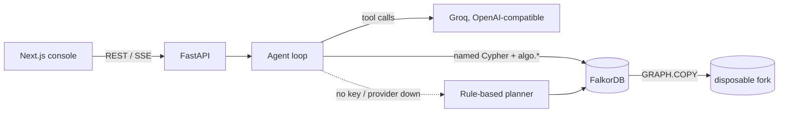

# Follow the Money

**An AML investigation agent that doesn't just find the mule ring - it tells you the smallest
freeze that stops it, and proves it on a copy of the graph before anyone touches a real account.**


Graph Hacks (WeMakeDevs x FalkorDB) - **Track 1: Agents That Act on Connected Data**

An analyst opens an alert ("14 transfers from A17 in two hours") and asks a question in plain
English. The agent works the transaction graph in FalkorDB: it pivots on shared phones and IPs,
measures whether the group behaves like a mule ring, reconstructs time-ordered money trails,
computes how much money the network can move, and then answers the question an AML team actually
has to decide on:

> *Freeze 2 accounts (A47, A52) - not 7. That cuts every route to the cash-out hub. Proven: the
> graph was copied, the two accounts removed, the algorithms re-run - capacity $30,100 -> $0, zero
> routes left. Freezing the alerted account alone would leave 74% flowing; freezing the obvious
> aggregator would leave 20% flowing through A77, an account that is not even in the ring.*

Every sentence links to evidence, and every piece of evidence carries the exact Cypher that produced
it, which you can replay.

---

## What is different here

| | |
|---|---|
| **Minimum freeze, proven** | Max-flow/min-cut over the money network finds the fewest, least-collateral accounts whose freeze severs *every* route. The plan is then verified inside FalkorDB on a fork (`GRAPH.COPY`) and compared with the naive plans an analyst would try. |
| **What-if forks** | Simulations never touch live data: copy the graph, delete the accounts, re-run SPpaths and max-flow, drop the copy. After a real freeze, every movement tool automatically reasons over the graph *as money can move today*. |
| **Receipts** | Each evidence item lists the named queries and parameters behind it. `POST /api/evidence/replay` re-runs one read-only and returns the same rows with a fingerprint. Judges can paste the Cypher into FalkorDB Browser. |
| **The model cannot overrule the graph** | The verdict (suspicious / no evidence) is a fixed rule over graph measurements. The LLM chooses tools and writes the narrative. If it disagrees with the rule, cites evidence that doesn't exist, or returns malformed output, its text is dropped and a deterministic summary is used. Actions are derived from evidence by the server; the model cannot propose or execute them. |
| **Time-respecting trails** | A shortest path is only called a money trail if real transfers follow it *in time order* with money not growing along the way. Coincidental routes through ordinary payments are labelled `structural`, not presented as laundering. |
| **Honest false alarms** | The busiest merchant tops the legacy anomaly score. The agent explains why (320 customers who each paid once, nothing passed on, settlements to the owner's own account) and recommends closing the alert. A family sharing a tablet is likewise cleared. |
| **Works without an LLM** | With no API key, or if the provider is down or rate-limited, a rule-based investigator runs the same tools. The demo never depends on a third-party API. |

## Why FalkorDB is load-bearing (rule 2)

Remove FalkorDB and nothing is left: no ring, no trail, no capacity, no plan, no proof.

| Capability | Graph operation | FalkorDB |
|---|---|---|
| Ring detection | Components of the account-device-IP graph | `algo.WCC` |
| Money trails | Shortest routes between accounts | `algo.SPpaths` |
| Hub ranking | Influence over transfers | `algo.pageRank` |
| Laundering capacity | Max-flow from entry mules to the cash-out hub | `algo.maxFlow` on builds that have it; identical result from the Python solver on `FLOWS_TO` edges read from FalkorDB otherwise |
| Freeze proof and what-if | Copy graph, delete accounts, re-run | `GRAPH.COPY` + the procedures above |
| Pivots, layering, forwarding speed | Multi-hop pattern matching | Cypher |
| Case store, audit trail | `Case`, `Investigation`, `Proposal`, `Action` nodes | Cypher writes, linked to the accounts they touched |

## Architecture



One investigation (`backend/agent/loop.py`):

1. **Tools** (`agent/tools.py`): 11 fixed, parameterised tools. The model picks tools and fills parameters; it never writes Cypher and has no write access.
2. **Evidence** (`agent/evidence.py`): every tool registers what it saw (`ev-1`, `ev-2`...) with node ids, edge ids, key numbers and query receipts.
3. **Verdict** (`agent/summarize.py`): suspicious if a mule ring was measured, a payment was traced through 3 or more fee-skimming hops, or 5 or more pass-through transfers were found. Otherwise no evidence. Thresholds sit at the top of `agent/tools.py`.
4. **Narrative**: the model's findings are kept only if they cite real evidence ids and agree with the verdict.
5. **Actions** (`agent/actions.py`): derived from evidence, each with evidence refs, and a simulation for freezes. Nothing changes until the analyst confirms.

## Graph data model

All data is synthetic, generated by `backend/seed/generator.py` with a fixed seed (42): 595 accounts, 8,317 transfers, 585 devices and 581 IPs.

**Nodes**

| Label | Key properties |
|---|---|
| `Customer` | `id`, `name` (synthetic), `segment` |
| `Account` | `id` (e.g. `A17`), `type` (personal / business / merchant / external), `opened_at`, `country`, `status` (active / flagged / frozen), `anomaly_score` (legacy rules-engine score) |
| `Device` | `id`, `kind` (mobile / desktop / tablet / pos) |
| `IPAddress` | `id`, `addr`, `asn_country` |
| `Case`, `Investigation`, `Proposal`, `Action` | the console's case store and audit trail |

**Relationships**

| Type | Direction | Properties |
|---|---|---|
| `OWNS` | Customer -> Account | `since` |
| `TRANSFER` | Account -> Account | `id`, `amount`, `ts` (epoch ms), `channel`, plus hidden ground truth `ring_id` and `is_laundering`, which only `seed/verify.py` reads |
| `FLOWS_TO` | Account -> Account | `capacity` (total money on the pair), `tx_count`, `first_ts`, `last_ts` |
| `USED_DEVICE` | Account -> Device | `last_seen` |
| `USED_IP` | Account -> IPAddress | `last_seen` |
| `HAS_INVESTIGATION`, `PROPOSES`, `HAS_ACTION`, `TARGETS` | case store | |

`FLOWS_TO` is one edge per ordered account pair, aggregated from `TRANSFER`. It exists because
`algo.maxFlow` requires a relationship type with no parallel edges (we confirmed this in FalkorDB's
source), and real transfer data has many payments between the same two accounts.

## Queries and algorithms

Every query the product runs lives in [`queries/`](queries/), and the backend loads them from there
by name. The folder is therefore exactly what runs; `GET /api/queries` lists it live.

| File | Contents |
|---|---|
| `00_seed.cypher` | indexes and bulk `UNWIND` loaders |
| `01_accounts.cypher` | account search, profile, anomaly rank, transfer history, capability probe |
| `02_rings.cypher` | shared-infrastructure pivot, **`algo.WCC`** components, layering (pass-through) pattern |
| `03_trails.cypher` | **`algo.SPpaths`** routes, transfers behind each hop, forward tracing of a payment |
| `04_flow.cypher` | **`algo.pageRank`**, **`algo.maxFlow`**, paged `FLOWS_TO` read, counterparty volumes, fork edit |
| `05_console.cypher` | case store, proposals, freeze/flag writes, audit trail, canvas subgraph |

## Demo scenarios (planted ground truth)

| Case | Question | What the agent finds |
|---|---|---|
| `case-001` | "Who is behind this burst of transfers?" | 7-account ring (3 shared phones, 2 IPs, 98% pass-through, ~13 minutes per hop), time-ordered trails to hub H3, capacity **$30,100**, **minimum freeze A47 + A52**, versus 74% and 20% left by the naive plans |
| `case-001` after freezing | "Is there any way around this freeze?" | No route remains; capacity $0 |
| `case-002` | "Follow the $9,800 from C42." | C42 -> A91 -> A33 -> A75 -> H1 in 26 minutes, 3.5-3.6% skimmed per hop; the three mules share a phone; freeze A75 |
| `case-003` | "Is M8 laundering money?" | **No evidence.** The #1 anomaly score is explained by 320 one-time customers; nothing is passed on |
| `case-004` | "Is the A95 cluster a mule ring?" | **No evidence.** A household sharing a tablet; 34% pass-through over days, not minutes |

`python -m seed.verify` asserts all of this through the product's own tools (17 checks).

## Run it locally

Requirements: Python 3.11+, Docker (or any FalkorDB 4.x).

```bash
docker compose up -d                      # FalkorDB on :6379, FalkorDB Browser on :3080

cd backend
python -m venv .venv && source .venv/bin/activate
pip install -r requirements-dev.txt
cp .env.example .env                      # add LLM_API_KEY for Groq, or leave empty for rule-based mode

python -m seed.load --verify              # build the demo graph, then run the 17 ground-truth checks
uvicorn app.main:app --reload --port 8000 # API at http://localhost:8000, docs at /docs

pytest -q                                 # 27 tests against the running FalkorDB (uses graph "ftm_test")
```

Try it:

```bash
curl -s -X POST localhost:8000/api/investigate -H 'Content-Type: application/json' \
  -d '{"question":"Who is behind this burst of transfers?","case_id":"case-001"}'
```

The FalkorDB Browser uses :3080 (compose mapping); the Next.js dev server keeps :3000.
If you change the compose mapping back to 3000, run the frontend on 3001 and set
`CORS_ORIGINS=http://localhost:3001`.

## Deploy (FalkorDB Cloud + Render)

1. Create a free FalkorDB Cloud instance and note the host, port and password (username `falkordb`; the free tier has no TLS).
2. Seed it from a laptop: `python -m seed.load --host <host> --port <port> --username falkordb --password <pw> --verify`
3. On Render, create a service from `render.yaml` and set `FALKORDB_HOST`, `FALKORDB_PORT`, `FALKORDB_PASSWORD`, `LLM_API_KEY` and `CORS_ORIGINS` (your Vercel URL). Render generates `BACKEND_API_TOKEN`.
4. Before a demo: reseed (step 2, or `POST /api/admin/reseed` with the token), then call `/api/health` to wake the free instance.

The free Cloud instance has no persistence and stops after a day idle; the seed script rebuilds the
identical world in about a second.

## API

| Method | Path | Purpose |
|---|---|---|
| `POST` | `/api/investigate` | Question in, complete investigation out |
| `POST` | `/api/investigate/stream` | Same, as Server-Sent Events: `step`, `finding`, `done` |
| `POST` | `/api/actions/execute` | Confirm a proposed action (needs `Authorization: Bearer <token>` when a token is set) |
| `GET` | `/api/cases`, `/api/cases/{id}` | Cases, past investigations, audit trail |
| `GET` | `/api/graph/snapshot?case_id=` | Subgraph for the canvas, with current account statuses |
| `GET` | `/api/cases/{id}/report?format=json\|markdown` | Evidence-linked case report |
| `POST` | `/api/evidence/replay` | Re-run a receipt (read-only queries only) |
| `GET` | `/api/queries` | Every Cypher query the product runs |
| `GET` | `/api/health` | DB, LLM and capability status |
| `POST` | `/api/admin/reseed` | Rebuild and verify the demo graph (token required) |

Full contract: [`docs/api-contract.md`](docs/api-contract.md). Real responses for every scenario:
[`frontend/lib/mocks/`](frontend/lib/mocks/). OpenAPI: `backend/openapi.json`.

## Engineering decisions

- **WCC, not label propagation, decides ring membership.** We tried CDLP over the transfer graph: on realistic background traffic it merged 585 of 595 accounts into one community, and it is documented as varying between runs. WCC over shared devices and IPs is deterministic and found every planted group exactly. Ring behaviour is then *measured* (pass-through ratio, minutes until money moves on), so a family sharing a tablet is not called a ring.
- **Forwarding speed is amount-aware.** An outflow counts as forwarded only if an earlier inflow was large enough to pay for it. Without this, a merchant's nightly settlement looks like rapid forwarding of the last card payment.
- **Freeze cost includes collateral.** Freezing an account costs 1 plus the share of its money exchanged with accounts outside the suspicious network, so the planner avoids freezing busy legitimate accounts (A77) when an equally small set of pure mules (A47, A52) works.
- **Python solver alongside `algo.maxFlow`.** Minimum cut has no FalkorDB procedure, and older FalkorDB builds lack `algo.maxFlow`. The solver reads `FLOWS_TO` from FalkorDB; `seed.verify` checks both engines agree when the native one exists.
- **Paged reads.** FalkorDB caps result sets (`RESULTSET_SIZE`, 10,000 in the Docker image). The one large read (`FLOWS_TO`) counts first and pages until complete. Tests pass with the cap at 700.
- **No agent framework.** The whole loop - tool calls, validation, fallback - is one readable file (`agent/loop.py`) on a plain HTTP client, so every decision it makes is visible and explainable.

## Limitations

- Capacity is measured on observed transfers in the data window, not as a per-day rate.
- The ring rule's thresholds (3+ accounts, 85% pass-through, 60 minutes) are tuned for this synthetic world and would need calibration on real data.
- One analyst persona, with no authentication beyond the shared action token; cases are not shared between users.

## AI-assistant disclosure (rule 11)

The backend was written with the help of an AI coding assistant (Claude, Anthropic).
**Team: before submitting, describe here what you reviewed, changed and can explain yourselves (rule 12).**
